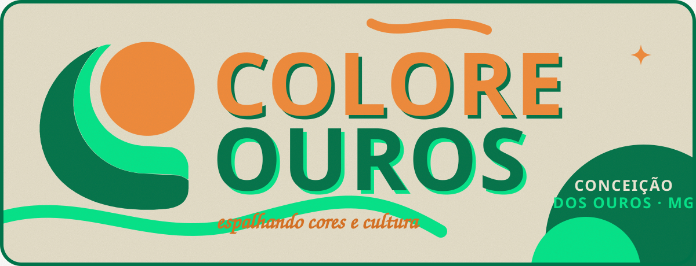
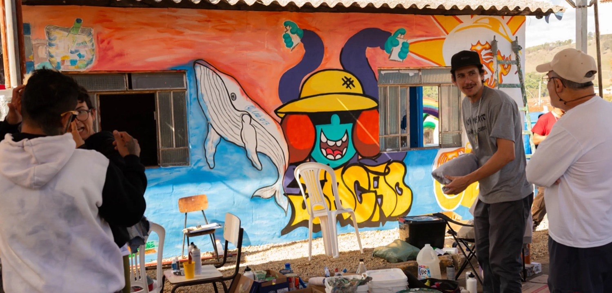
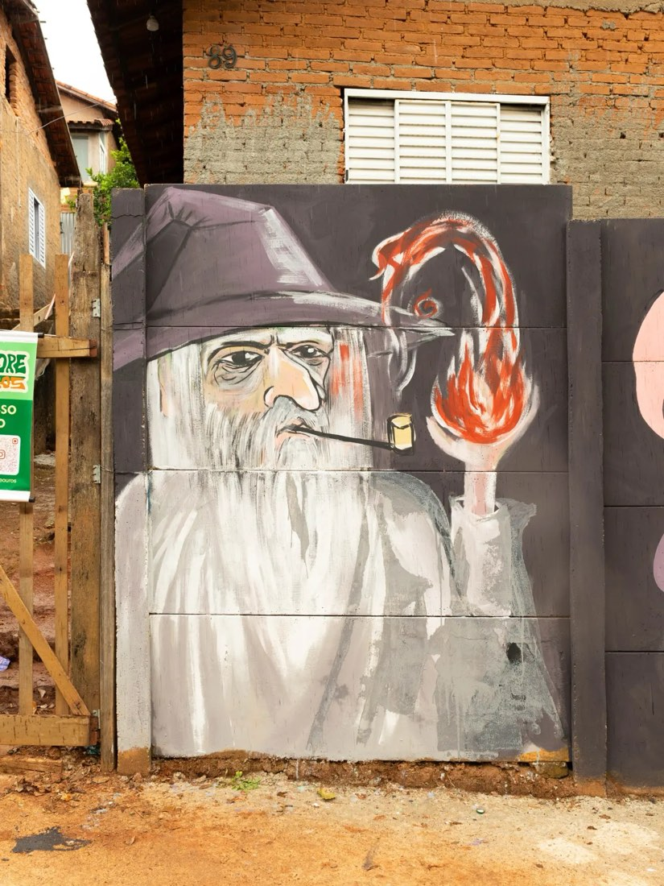
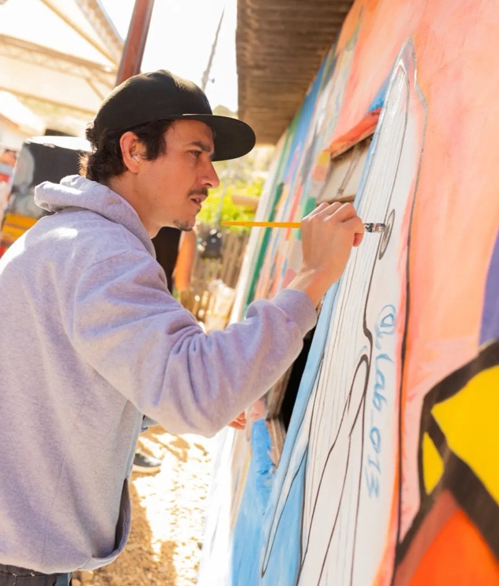
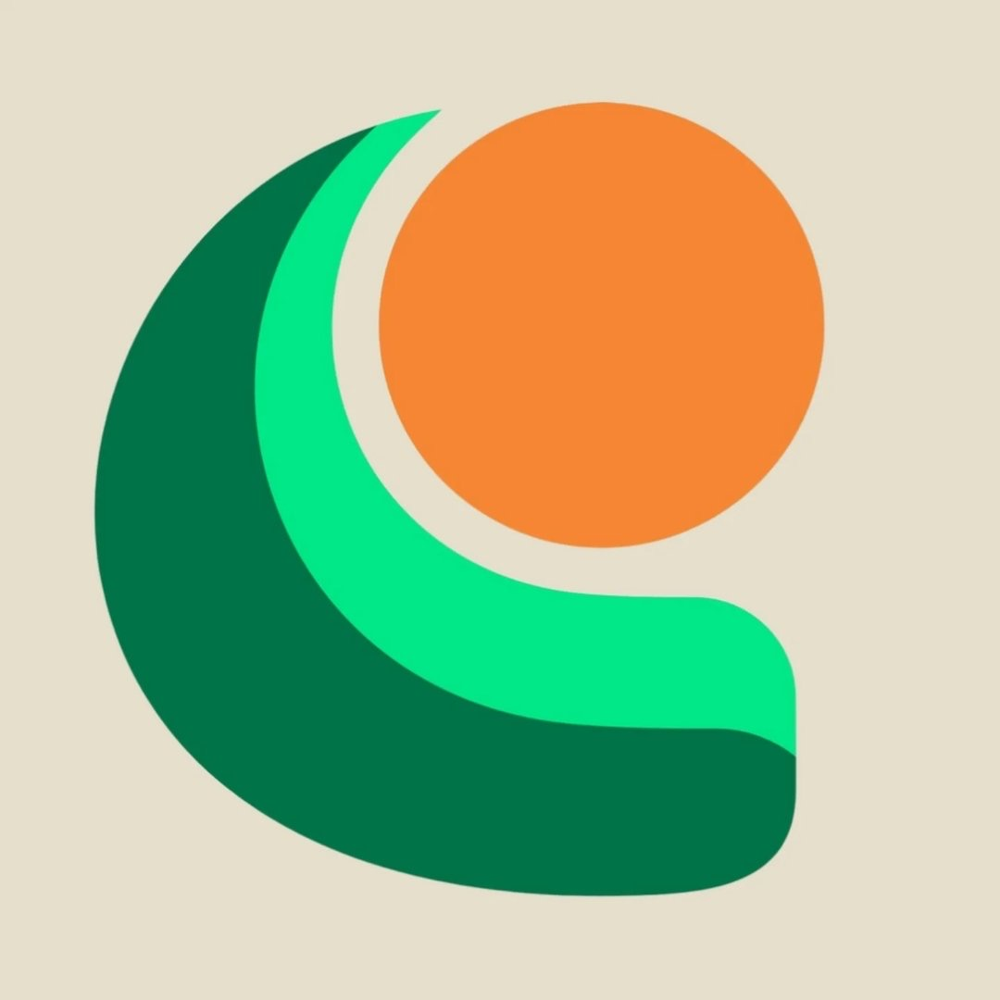

<p align="center">
  <a href="https://viniciuscastro999.github.io/coloreouros/">
    
  </a>
</p>

<p align="center">
  <a href="https://viniciuscastro999.github.io/coloreouros/"></a>
  <a href="https://viniciuscastro999.github.io/coloreouros/projetos.html"></a>
  <a href="https://www.instagram.com/coloreouros/"></a>
</p>

<h3 align="center">🧡 a parede é de todo mundo 💚</h3>

<p align="center">
O <b>Colore Ouros</b> é um coletivo de artistas de Conceição dos Ouros, no sul de Minas.<br>
Professores, pintores, ilustradores, grafiteiros e contadores de histórias<br>
que pegam tinta, pincel e a rua como tela.
</p>

<p align="center">
  
  
  
</p>

---

## ✺ o que tem aqui

Este repositório é o site do coletivo. Tudo feito à mão, sem framework e sem servidor: HTML, CSS e JavaScript puros, publicados de graça no GitHub Pages.

| | |
|:--|:--|
| 🎨 **Parede que se pinta** | O topo do site é uma parede: passa o dedo ou o mouse e ela ganha cor. |
| 🖼️ **Projetos** | Cada projeto vira um cartão na home e uma parte na [página de projetos](https://viniciuscastro999.github.io/coloreouros/projetos.html), com fotos em colagem. |
| 🗺️ **Arte pela cidade** | Um mapa com os murais e os projetos espalhados pela região. Quem cuida dos pontos é uma planilha do Google. |
| 🧑‍🎨 **Quem faz acontecer** | Os idealizadores e colaboradores, cada um com sua história. |
| 💥 **Jogue tinta** | No fim da página, clicar espirra tinta na tela. Vai lá testar. |

---

## ✺ como atualizar

### 🗺️ uma arte nova no mapa

O mapa lê a [planilha do coletivo](https://docs.google.com/spreadsheets/d/19nOOmSqQqRDxrJcpooilH6-NgvOTnHX-bnZUeBY3zuI/edit). Não precisa mexer em código:

1. Adicione uma linha com o nome da obra, artista, endereço e o link do Google Maps (ou as coordenadas).
2. Coloque uma foto (link do Google Drive funciona).
3. Marque **sim** na coluna de aprovação.

Pronto. Em poucos minutos o ponto aparece no mapa do site.

### 🖼️ um projeto novo

Os projetos ficam em [`projetos-dados.js`](projetos-dados.js). Copie um bloco, troque os textos e as fotos, e a home, a página de projetos e o mapa se atualizam juntos.

```js
{
  id: "nome-do-projeto",
  titulo: "Nome do Projeto",
  status: "realizado",           // ou "em breve"
  quando: "dezembro de 2026",
  lugar: "Rua tal, 123",
  pos: [-22.4097, -45.7978],     // latitude e longitude, ou null
  resumo: "Uma frase pro cartão da home.",
  texto: ["Um parágrafo.", "Outro parágrafo."],
  fotos: [
    { src: "assets/projetos/pasta/foto.jpg", cap: "legenda à mão", alt: "o que aparece na foto" },
  ],
}
```

As fotos vão em `assets/projetos/<nome-do-projeto>/`. Fotos de até uns 1100 px de largura deixam o site leve.

---

## ✺ rodar no computador

```bash
python3 -m http.server 8765
```

Depois é só abrir `http://localhost:8765` no navegador.

```
.
├── index.html           a página principal
├── projetos.html        a página de projetos
├── style.css            todas as cores, formas e animações
├── main.js              parede que se pinta, tinta, animações e vitrine
├── projetos.js          monta a página de projetos
├── projetos-dados.js    a lista de projetos
├── mapa.js              mapa e leitura da planilha
└── assets/              fotos, logo e banner
```

---

## ✺ paleta

<p>
  
  
  
  
</p>

Letras em **Anton** (títulos), **Rubik** (texto) e **Caveat** (a letra de mão das legendas).

---

## ✺ quem faz

**Idealizadores:** Alex ([@lab_013](https://www.instagram.com/lab_013/)), Rubia (Artub), Natanael ([@martell_artes](https://www.instagram.com/martell_artes/)) e Elizeu ([@olhovivo.art](https://www.instagram.com/olhovivo.art/))
**Colaboradores:** Viktor Monteiro Lopes ([@viktormonteirolopes](https://www.instagram.com/viktormonteirolopes/)) e Thiago

Fotos dos projetos: [@coloreouros](https://www.instagram.com/coloreouros/) e [@viktormonteirolopes](https://www.instagram.com/viktormonteirolopes/).
Mapa: [Leaflet](https://leafletjs.com/) e [OpenStreetMap](https://www.openstreetmap.org/copyright).

<br>

<p align="center">
  <br>
  <b>tem um muro pra gente pintar?</b><br>
  <a href="https://www.instagram.com/coloreouros/">chama no @coloreouros</a>
</p>
